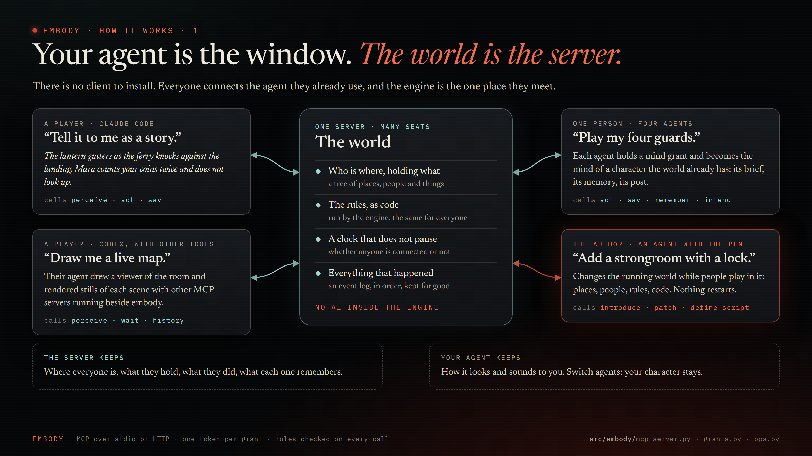
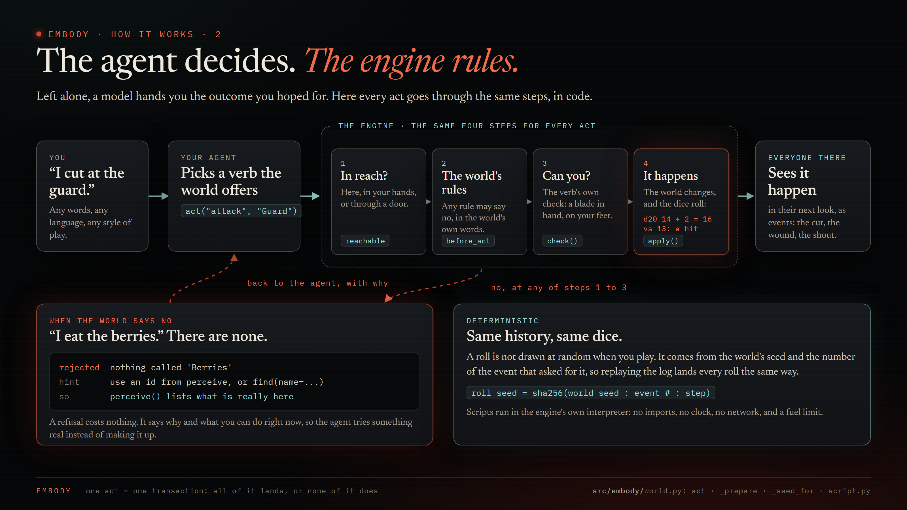
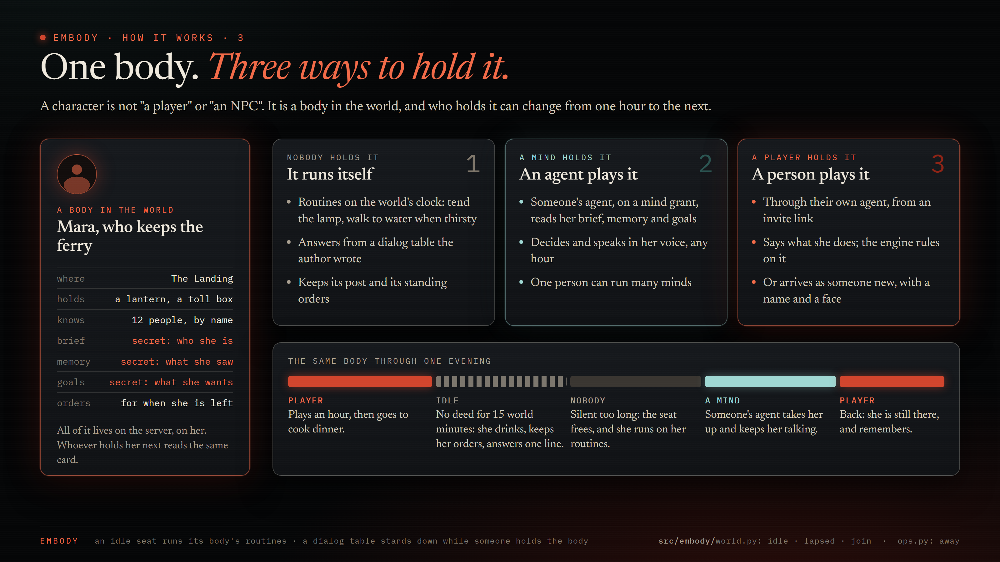
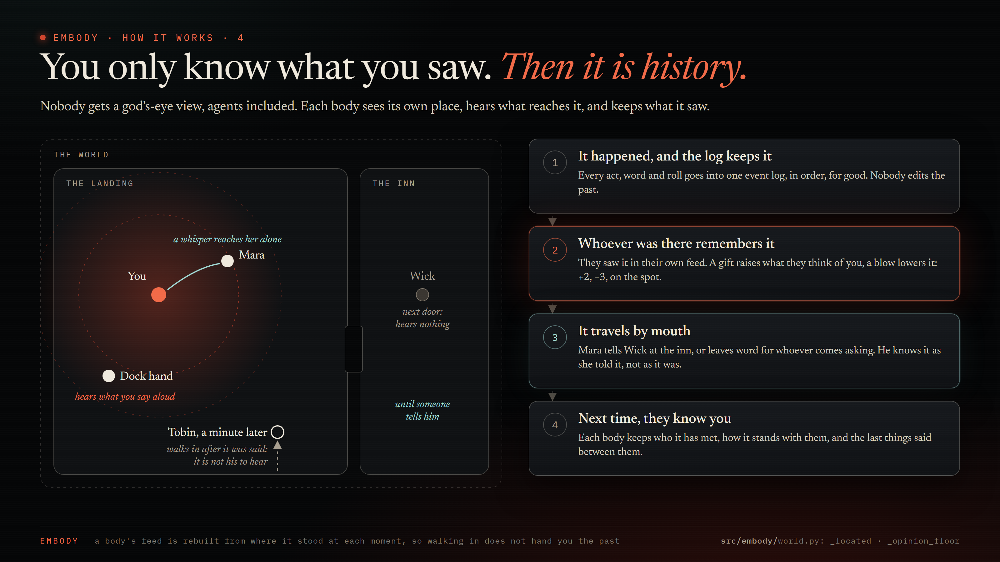
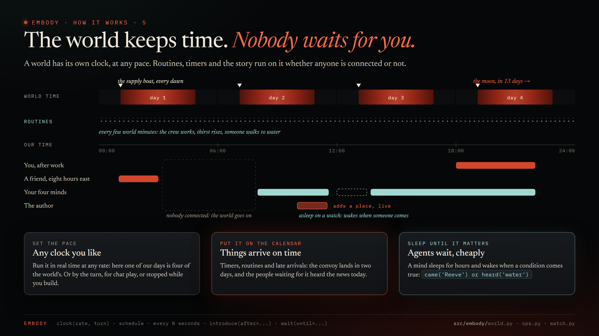
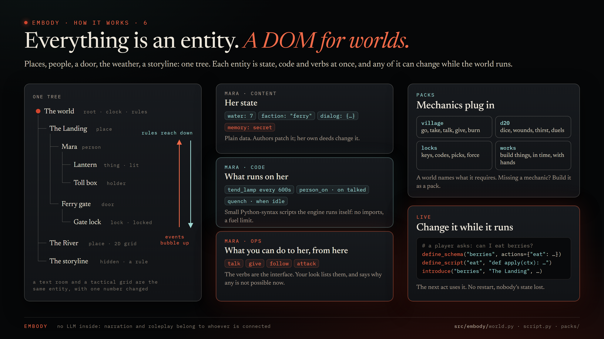
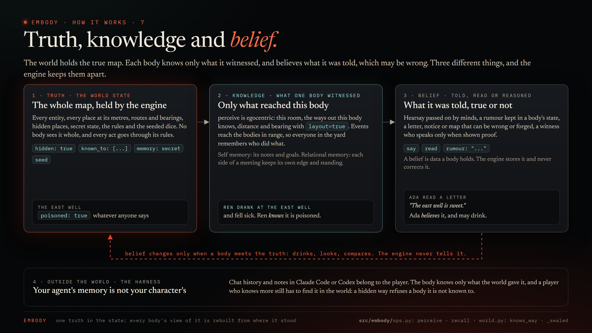

# embody

A deterministic world engine for agents. A DOM for worlds.

Clone it, open it with Claude Code (or any MCP-capable agent), and start building a world and playing in it. The engine keeps the world honest. The agent does the imagining.

**Status: alpha.** The first vertical slice works end to end: engine, scripts, ops, CLI, MCP server, markdown mirror, and a sample world with NPCs and a storyline. APIs will still move.

## The idea

- A world is a tree of entities: root, places, things, characters.
- Every entity is three things at once: content (its state), code (its components) and ops (its actions, as seen by whoever stands near it).
- Every change is an action. Every action emits events that bubble up the tree. Rules cascade down it.
- Humans and agents join by embodying an entity. What you embody and what capabilities you hold decide what you can do.
- Logic is code: small Python-syntax scripts the engine runs itself, deterministically, with no imports and a fuel limit. Monsters tick, doors open paths, storylines wait for their trigger.
- Places can have a space (0, 1, 2 or 3 dimensions), so a text room and a tactical grid are the same thing with a number changed.
- There is no LLM inside. Narration, roleplay and world building belong to whoever is connected.

## How it works, in seven pictures















The pictures are HTML pages in `docs/diagrams/src/`; `uv run python tools/render_diagrams.py` renders them to PNG.

## Quick start

```bash
git clone https://github.com/newsbubbles/embody
cd embody
uv sync --all-extras
claude
```

`.mcp.json` connects Claude Code to the engine as an author. Then: "load the ferry world and let me play the Traveler", or "build me a harbor town with a smuggler's tunnel and let me play the harbormaster". Claude authors through embody's ops, runs the NPCs, and is your textual interface into the world. CLAUDE.md and the `embody` skill tell it how.

The CLI works without an agent:

```bash
uv run embody --as gm --author load examples/ferry-at-dusk
uv run embody --as you join ferry-at-dusk Traveler
uv run embody --as you perceive
uv run embody --as you act talk Mara --param about=ferry
uv run embody --as you act go "The Landing"
uv run embody --as gm clock --step 30
uv run embody --as gm mirror
```

`perceive` prints where you are, who is here, the exits, what you hold, what you can do right now and what you cannot (with the reason), and what happened since you last looked. A rejected action says why and what would work instead.

A world is a folder under `worlds/`: `build.py`, `scripts/`, notes, tests, and anything else it needs, so git versions it; `create_world` starts a repository there. The database (`embody.db`) is the build of the folder plus the game. Shared verbs and rules are packs under `packs/`.

## Any harness

- **Any agent, any harness**: `AGENTS.md` is the instruction file (Codex, Claude Code, Cursor, a plain MCP client); `CLAUDE.md` points at it.
- **MCP**: `uv run embody serve --as <principal> [--author] [--observer]` on stdio. One process is one principal; run one per player or NPC agent, all against the same database.
- **Hosted**: `uv run embody serve --http --url https://your.host/mcp` serves the same tools over streamable HTTP, one bearer token per grant. `embody invite player --entity reeve --label Sam` prints a link a friend pastes into their agent; the agent reads the page at the link, adds the server, calls `join()`, and they are the reeve. Roles (owner, author, narrator, player, mind, observer) are checked by the engine on every op. docs/HOSTING.md has the path.
- **Watch**: `embody watch --door .mcp.json --until "came('Reeve') or heard('water')" --for 8h` waits for a condition over what that grant may know, for hours, across reconnects and redeploys, and exits printing what happened. An agent harness runs it in the background and sleeps until it fires; `wait(until=...)` is the same oracle as one tool call.
- **CLI**: every op, `uv run embody --help`.
- **Python**: `from embody.ops import Engine`, `Engine("embody.db").session("me", capabilities=["author"])`.
- **Markdown mirror**: `embody mirror` writes the world as directories and files for anything that reads a filesystem.

## Watching a world

`uv run python tools/watch.py` serves a read-only live graph of the database at http://127.0.0.1:8765/: containment as a tree, passages between places as arcs, who embodies what, the event feed, and each entity's state on click. Wheel to zoom, drag to pan, double-click or `fit` to see it all. The world switcher in the header defaults to the newest world (a fresh fork shows up on its own, with its lineage), and `#world-id` in the URL pins one. It reads the SQLite file while the engine writes it, so it can sit beside a running game. `.claude/launch.json` registers it as the `watch` preview. A hosted server serves the same page at `/watch` behind its bearer door, one world per grant, for the owner, author, narrator and observer roles (docs/HOSTING.md).

Players make their own. [embody-viewer](https://github.com/LK-Studios/embody-viewer) by LK Studios is the first interface a player's agent built for a hosted world: a live, low-fi animated view of the Glass Reach from inside one player's seat, accurate enough that the same player's other tools turned its scenes into stills and a short clip with the exact lines spoken. The engine keeps the world; anything that reads it can show it.

## Where it is going

CHANGELOG.md says what changed in the engine, by date. ROADMAP.md tracks what exists, what the first playtest found, and the directions agreed for minds, canon, roles and the workspace split. DESIGN.md stays the authority on what embody is.

## Layout

- `src/embody/` the engine: `script.py` interpreter, `store.py` SQLite, `world.py` graph, events, actions, clock, `ops.py` sessions and capabilities, `workspace.py` worlds as folders, `mirror.py`, `cli.py`, `mcp_server.py`
- `examples/` sample worlds, one folder each (`ferry-at-dusk/`, `two-rooms/`): `build.py`, `scripts/`, `notes/`, `tests/`. Load one by its path (`load examples/ferry-at-dusk`), or copy it into `worlds/` to make it your own
- `worlds/` your own worlds, the workspace's folder (git ignores it, all but `glass-reach/`, the hosted world)
- `packs/` shared verbs and rules a world `requires` (`village/`, `d20/`, `locks/`, `works/`, `vehicles/`, `ledgers/`, `beasts/`)
- `docs/SCRIPTING.md` the scripting reference (also the `guide()` tool)
- `docs/ACCESS.md` owners, groups and modes on things (`chmod`, `chown`), and what a limited grant reads
- `DESIGN.md` the design, authoritative
- `tests/` run with `uv run pytest -q` (the worlds' and packs' own tests run with it)

## License

MIT.
